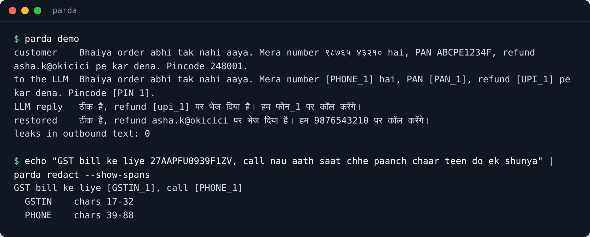

# parda

*parda* (पर्दा): a curtain.

parda replaces Indian personal identifiers with tokens before text goes to an LLM, then puts
the real values back into the model's reply, even after the model has lowercased the
tokens, dropped the brackets or translated the labels into Hindi.

```python
from parda import Parda

p = Parda()                      # one per conversation; the mapping stays in memory
safe = p.redact("Mera number ९८७६५ ४३२१० hai, refund asha.k@okicici pe kar do")
safe.text   # 'Mera number [PHONE_1] hai, refund [UPI_1] pe kar do'

reply = call_your_llm(safe.text) # 'ठीक है, refund [upi_1] पर भेज दिया। फोन_1 पर कॉल करेंगे।'
p.restore(reply).text            # 'ठीक है, refund asha.k@okicici पर भेज दिया। 9876543210 पर कॉल करेंगे।'
```



## Why

Customers in India paste PAN numbers, UPI IDs and phone numbers into support chats as a
matter of course, often in Devanagari digits or spelled out ("nau aath double saat…").
If that chat goes to a hosted model, so does their data. The DPDP Rules were notified in
November 2025, with most obligations phased in over the following 18 months, so this now
has a deadline attached.

Redaction tools exist ([Presidio](https://github.com/microsoft/presidio) has India
recognisers, and there are smaller India-specific libraries). The part I couldn't find
measured anywhere is the return trip. Once a model has seen `[UPI_1]`, does the value come
back in its reply? A plain `str.replace` restore only works if the model copied the token
exactly. Often it doesn't.

## Install

```bash
pip install git+https://github.com/yashere69/parda
parda demo
```

No dependencies outside the standard library.

## What it finds

| Kind | How it's confirmed |
|---|---|
| Aadhaar | 12 digits, first digit 2–9, **Verhoeff** check digit |
| GSTIN | state code + PAN + entity + `Z` + **mod-36 check character** |
| PAN | shape, with the 4th letter restricted to valid holder types |
| Phone | Indian mobile (6–9 start), with or without `+91`/`0`, grouped 5-5 or plain |
| UPI | `handle@psp`, kept apart from email by the dotless PSP part |
| IFSC, email | shape |
| Card | 13–19 digits, **Luhn** |
| PIN code | 6 digits **only** when "pin", "pincode", "postal" or पिन appears just before it |

Numbers in Devanagari digits (`९८७६५`) and spoken numbers in English, romanised Hindi or
Devanagari words ("nau aath double saat…", "नौ आठ सात…") are handled too. When spans
overlap, the longest wins, so a GSTIN isn't also reported as the PAN inside it.

Already running Presidio or a name recogniser? Pass its spans in as `extra=` and parda
tokenises those too: `p.redact(text, extra=[Span(0, 11, "NAME", "Asha Sharma")])`.

## How well it works

`python tools/benchmark.py` regenerates [results/benchmark.md](results/benchmark.md). The
corpus is 600 generated Hinglish/Hindi messages, and a quarter of them are negatives:
order ids, invoice numbers, prices, dates.

**Detection**

| Kind | Precision | Recall |
|---|---|---|
| PAN, GSTIN, IFSC, UPI | 100% | 100% |
| Aadhaar | 97.4% | 100% |
| Phone | 84.9% | 86.3% |
| PIN | 100% | 54.3% |

The misses are real limits, not noise:

- **Phone recall** fails on US-style `987 654 3210` grouping (0/16). That grouping is rare
  in Indian chats, but it happens.
- **Phone precision**: a 10-digit order id starting with 6–9 looks exactly like a mobile
  number, so parda redacts it. That fails safe (the model just sees a token), but your
  agent loses the order id unless you whitelist the format.
- **PIN recall**: without a cue word, "Dehradun 248001" is left alone on purpose. Six
  digits on their own are too often prices, quantities or codes.

The generator and the detectors were written by the same person, so expect real traffic
to score lower than this. That's why the corpus deliberately includes forms the detectors
miss.

**Round trip.** The share of replies with every value restored, after the tokens are
rewritten the way models tend to rewrite them:

| Rewrite in the reply | `str.replace` | parda |
|---|---|---|
| verbatim `[UPI_1]` | 100% | 100% |
| lowercase `[upi_1]` | 0% | 100% |
| brackets dropped `UPI_1` | 0% | 100% |
| `UPI 1` | 0% | 100% |
| label in Hindi `[यूपीआई_1]` | 0% | 100% |
| label and digit in Hindi `[यूपीआई_१]` | 0% | 100% |
| label renamed `[MOBILE_1]` | 0% | 0% |

These rewrites are simulated, so the table shows what the restorer tolerates; it can't
tell you how often a given model rewrites tokens. To measure that, point the same script
at a real model:
`PARDA_API_KEY=… python tools/benchmark.py --endpoint <openai-compatible-url> --model <name>`.

## Decisions worth knowing about

- **Opaque tokens, not fake look-alike values.** Swapping a real PAN for a fake but valid-looking
  one helps the model reason ("it's a PAN"). But PAN and phone numbers have no check digit,
  so a fake can collide with a real person's ID. The token already carries the type in its
  label.
- **Restore is tolerant only towards tokens it issued.** It accepts case, bracket, separator
  and Hindi-label variants of `KIND_n`, but only for kinds that appeared in this session.
  An index it never issued (`[UPI_2]` when only one UPI was seen) is reported in
  `RestoreResult.unknown` and left as-is, never filled with a guess.
- **Values come back canonical.** A phone number spoken as words returns as `9876543210`,
  and a lowercase PAN returns in capitals. That's what tools and databases downstream want.
  If you need the customer's original spelling back, the spans on `Redacted` have the offsets.
- **The mapping never leaves memory.** There's no persistence and no logging of values. The
  CLI's `--show-spans` prints kinds and offsets, never the values.
- **`leaks()` is a smoke check, not a guarantee.** It runs the same detectors over the
  outgoing text, so it can't catch what the detectors miss.

## Not covered

- Names and street addresses. These need NER; pass spans from Presidio or spaCy through
  `extra=`.
- Voter ID, passport, driving licence, vehicle numbers
- Images, PDFs, audio

Redaction is one control among several. Using parda doesn't make a system DPDP-compliant.

## Development

```bash
pip install -e ".[dev]"
ruff check . && mypy src && pytest
```

Example identifiers in the tests and the benchmark are generated so that their check digits
pass. Any match with a real person's ID is accidental, and the generated corpus is never
written to disk.

MIT licensed.
