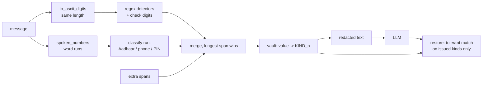

# Inside parda



## Offsets

Every detector has to report spans in the *original* string, because that's where the
replacement happens. Two tricks keep this simple:

1. Devanagari digits `०–९` are single code points, so translating them to `0–9` with
   `str.translate` keeps every offset where it was. Regexes run on the translated copy,
   and their spans apply unchanged to the original.
2. Spoken numbers aren't translated at all. `spoken_numbers` tokenises the original text,
   walks runs of digit-words (with "double"/"triple"/डबल), and returns the start of the
   first word and the end of the last, plus the digits they spell.

## Why spoken runs need six digits

"do" is 2 in Hindi and a verb in English. "che", "sat" and "tin" are ordinary words too.
A run counts only if it has at least one word token and spells six or more digits, which
is the shortest thing worth redacting (a PIN). After that the digit string is classified:
12 digits passing Verhoeff is Aadhaar, 10 digits starting 6–9 is a phone, 6 digits after a
cue word is a PIN. Anything else is ignored.

## Tokenising Devanagari

Python's `\w` doesn't match Devanagari vowel signs (they're combining marks), so a pattern
like `[^\W\d_]+` splits नौ into न and ौ. The tokeniser gives the Devanagari block its own
character class and leaves the danda (।) out of it, so it still ends a sentence.

## Restore pattern

For the kinds seen in this session, plus their Hindi labels, restore compiles one regex:

```
(optional [ or << or **) LABEL (space, _ or -)? DIGITS (optional ] or >> or **)
```

`DIGITS` is `\d+`, which in Python also matches Devanagari digits, and `int("१")` is 1,
so `[यूपीआई_१]` resolves. The label has to start at a word boundary, so `SMARTPHONE_1`
doesn't match `PHONE_1`.

## What the benchmark is and isn't

`bench.corpus` builds messages from templates. Negatives make up a quarter of them, and
some forms are included specifically because the detectors miss them (3-3-4 phone
grouping, PIN without a cue word). The round-trip transforms are hand-written imitations
of model behaviour. Both are useful for regression testing and for comparing restore
strategies, and neither replaces measuring your own traffic and your own model.
`live_roundtrip` exists for that.
